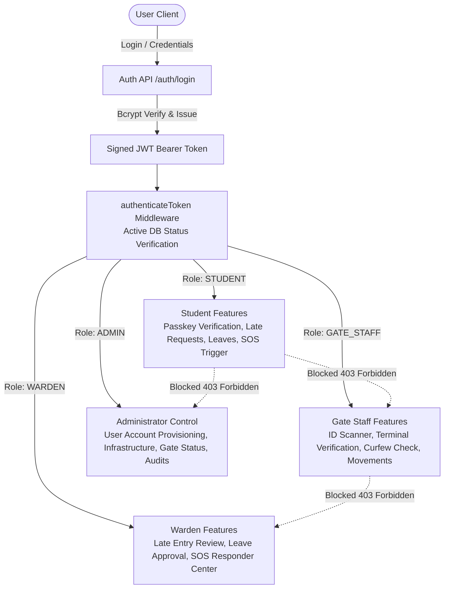
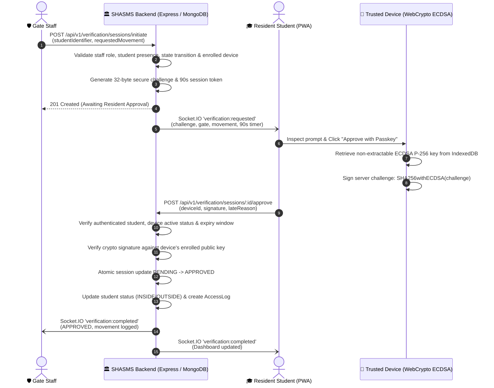

# Smart Hall Access & Safety Management System (SHASMS)

**SHASMS** is an enterprise-grade, university Residential Hall Access & Safety Progressive Web Application (PWA) built for **Pritilata Waddedar Female Residential Hall**. It replaces manual logbooks with a cryptographic, role-based system for gate access verification, curfew policy tracking, advance late-entry permissions, multi-day leave management, and real-time emergency SOS assistance.

---

## 🏛️ Security Architecture & Role-Based Access Control (RBAC)

SHASMS strictly enforces **Server-Side Role-Based Access Control** across four discrete institutional personas:



### 1. The Four System Roles

| Role | Target User | Capabilities & Permissions |
|---|---|---|
| **`STUDENT`** | Resident Student | View personal digital hall pass, inspect own entry/exit logs, manage enrolled WebCrypto passkey devices, submit advance late-entry requests, apply for multi-day leaves with guardian consent, and trigger emergency SOS distress signals. |
| **`GATE_STAFF`** | Security Gate Guard | Access real-time gate scanner terminal, initiate cryptographic gate verification sessions, check active student late permissions and sanctioned leave grants, and log verified movements. |
| **`WARDEN`** | Hall Provost / Warden | Review authorized student dossiers, review & approve/reject advance late-entry requests with decision notes, adjudicate leave applications with parental consent, dispatch responders to emergency alerts, and issue late citations. |
| **`ADMIN`** | Central Administrator | Full institutional authority: provision student, gate staff, warden, and administrator accounts; manage halls, rooms, and access gates; activate/suspend accounts; and monitor live system health. |

---

## 🔐 Core Feature: Cryptographic Entry/Exit Verification

SHASMS replaces outdated static QR codes, PINs, and easily forged browser IDs with an **Asymmetric Cryptographic Challenge-Response Protocol** using enrolled trusted devices:



### Security Guarantees & Attack Mitigations
1. **No Static PIN or QR Spoofing:** Static QR codes and PINs can be forwarded or photographed. Verification requires an explicit signature generated by a non-extractable private key stored securely in the student's browser `IndexedDB`.
2. **Mandatory Device Enrollment Re-Authentication:** Before a hardware key pair can be registered, the student must re-authenticate with their account password. The browser creates an ECDSA P-256 key pair with `extractable: false` and registers the SPKI public key with the server.
3. **Hardware Credential Revocation:** Students can view all registered devices and revoke any device at any time (`PATCH /api/v1/devices/:id/revoke`). Revoked credentials cannot approve verification sessions.
4. **Replay & Concurrency Protection:** Each challenge consists of 32 cryptographically secure random bytes with a 90-second expiration. Sessions transition atomically (`findOneAndUpdate({ _id, status: 'PENDING' })`). Attempting to replay, duplicate, or approve an already resolved session fails with `409 Conflict`.
5. **Physical State Transition Defenses:**
   - A student recorded as `INSIDE` cannot record `ENTRY`.
   - A student recorded as `OUTSIDE` cannot record `EXIT`.
6. **Explicit Denial & Audit Logs:** If a student receives an unauthorized verification request, they can explicitly click **DENY**, immediately notifying Gate Staff and logging the incident without changing presence status or creating movement logs.
7. **Socket.IO Engine with Polling Fallback:** Gate staff terminals and student PWAs communicate via WebSocket rooms (`gate:terminal`, `warden:desk`, `student:${id}`). If WebSocket connectivity drops, a background polling fallback (`/verification/sessions/:id/status`) updates every 2 seconds.

---

## 📋 The Three Complete Operational Workflows

### Workflow A: Advance Late Entry Permission
1. **Submission:** Students submit an advance request via their authenticated portal with the target date, expected arrival time (e.g. `21:30`), and reason.
2. **Curfew Policy Check:** Standard hall curfew is **8:00 PM (20:00)** with a 15-minute grace period. Requests arriving past curfew are queued for Warden sign-off.
3. **Warden Review:** Wardens view pending requests in their Late Review Desk and can `APPROVE` or `REJECT` with a decision note (e.g., *"Approved for university laboratory research"*).
4. **Gate Staff Verification:** When verifying a student arriving late, Gate Staff can check the current approved permission.
5. **Policy Decoupling:** An approved late entry request does **not** create a movement record; standard cryptographic gate verification is still required upon physical arrival.
6. **Cancellation:** Students can cancel their own pending late entry request prior to review.

### Workflow B: Multi-Day Leave Management
1. **Submission:** Students submit departure date, expected return date, destination address, guardian phone, reason, and certified parental consent.
2. **Server-Side Validation:** Departure and return dates are validated (return date must be after departure date).
3. **Warden Adjudication:** Wardens review applications and approve or reject them with review notes.
4. **Student Tracking:** Students track leave progress in real time via `/leaves/my-leaves`.
5. **Gate Staff Visibility:** Gate Staff can query `/leaves/authorized-permissions` to see authorized departures.
6. **Policy Decoupling:** An approved leave request does **not** equal departure; the physical exit movement must still be verified and recorded at the gate.
7. **Cancellation:** Students can cancel pending leave applications.

### Workflow C: Emergency Assistance (SOS)
1. **Distress Signal Trigger:** Students click the Emergency SOS button (or select emergency category: `MEDICAL`, `SECURITY`, `HARASSMENT`, `FIRE`, `OTHER`) and location to broadcast an immediate alert.
2. **Real-Time Notification:** On-duty guards, gate staff, and wardens receive instant in-app alerts and Socket.IO audio/visual broadcasts.
3. **Privacy Protection:** Sensitive student contacts and notes are restricted to authorized personnel (`GATE_STAFF`, `GUARD`, `WARDEN`, `ADMIN`); students cannot inspect other residents' emergency alerts.
4. **Responder Dispatch:** Authorized staff click **Acknowledge & Dispatch** (`PATCH /sos/:id/acknowledge`), moving the status to `ACKNOWLEDGED` and recording the responder's identity and timestamp.
5. **Incident Resolution:** Staff resolve the incident (`PATCH /sos/:id/resolve`) by recording formal resolution notes and safety confirmation.
6. **Action Logging:** Every state transition (`TRIGGERED` → `ACKNOWLEDGED` → `RESOLVED`) is saved in the database audit log.

---

## 🌐 Complete REST API Reference

All protected endpoints require an `Authorization: Bearer <JWT>` header.

### Authentication & User Management
| Method | Endpoint | Allowed Roles | Description |
|---|---|---|---|
| `POST` | `/api/v1/auth/register` | Public | Student account registration (strictly enforces `STUDENT` role) |
| `POST` | `/api/v1/auth/login` | Public | Authenticates credentials and returns signed JWT + user profile |
| `POST` | `/api/v1/auth/logout` | Authenticated | Clears user session |
| `GET` | `/api/v1/auth/profile` | Authenticated | Retrieves current authenticated user profile |
| `GET` | `/api/v1/auth/demo-accounts` | Public | Provides safe demo evaluation accounts |
| `POST` | `/api/v1/admin/users` | `ADMIN` | Provisions privileged accounts (`GATE_STAFF`, `WARDEN`, `ADMIN`) |
| `GET` | `/api/v1/admin/users` | `ADMIN` | Lists all managed system accounts |
| `PATCH` | `/api/v1/admin/users/:id/status`| `ADMIN` | Suspends or activates user account |

### Student Management & Verification
| Method | Endpoint | Allowed Roles | Description |
|---|---|---|---|
| `GET` | `/api/v1/students/my/profile` | `STUDENT`, `ADMIN` | Resident student personal profile, access logs & leaves |
| `GET` | `/api/v1/students` | Staff, Warden, Admin | Paginated search & filter of student resident records |
| `GET` | `/api/v1/students/:id` | Staff, Warden, Admin | Resident profile dossier with contact & recent logs |
| `POST` | `/api/v1/devices/enroll` | `STUDENT`, `ADMIN` | Enrolls cryptographic ECDSA device with password re-auth |
| `GET` | `/api/v1/devices/my` | `STUDENT`, `ADMIN` | Retrieves student's enrolled trusted devices |
| `PATCH` | `/api/v1/devices/:id/revoke` | `STUDENT`, `ADMIN` | Revokes hardware device credential |
| `POST` | `/api/v1/verification/sessions/initiate` | Staff, Admin | Initiates single-use gate verification session (90s TTL) |
| `POST` | `/api/v1/verification/sessions/:id/approve` | `STUDENT`, `ADMIN` | Approves session with cryptographic signature |
| `POST` | `/api/v1/verification/sessions/:id/deny` | `STUDENT`, `ADMIN` | Explicitly denies verification session |
| `GET` | `/api/v1/verification/sessions/:id/status` | Authenticated | Status probe for polling fallback |
| `GET` | `/api/v1/verification/sessions/pending-for-me` | `STUDENT`, `ADMIN` | Checks for pending verification challenge for student |

### Late Entry, Leave & Emergency SOS
| Method | Endpoint | Allowed Roles | Description |
|---|---|---|---|
| `POST` | `/api/v1/late-entries` | `STUDENT`, `ADMIN` | Submits advance late entry permission request |
| `GET` | `/api/v1/late-entries/my` | `STUDENT`, `ADMIN` | Retrieves student's own late entry applications |
| `GET` | `/api/v1/late-entries` | Staff, Warden, Admin | Lists late entry requests with optional status filter |
| `GET` | `/api/v1/late-entries/check-permission/:id` | Staff, Warden, Admin | Checks student's active approved late permission |
| `PATCH` | `/api/v1/late-entries/:id/review` | `WARDEN`, `ADMIN` | Approves or rejects late entry request with decision note |
| `PATCH` | `/api/v1/late-entries/:id/cancel` | `STUDENT`, `ADMIN` | Cancels student's own pending late entry request |
| `POST` | `/api/v1/leaves` | `STUDENT`, `ADMIN` | Submits multi-day leave application with guardian consent |
| `GET` | `/api/v1/leaves/my-leaves` | `STUDENT`, `ADMIN` | Retrieves student's submitted leave applications |
| `GET` | `/api/v1/leaves` | `WARDEN`, `ADMIN` | Lists all leave applications for review |
| `GET` | `/api/v1/leaves/authorized-permissions` | Staff, Warden, Admin | Lists active sanctioned leaves for gate visibility |
| `PATCH` | `/api/v1/leaves/:id/status` | `WARDEN`, `ADMIN` | Approves or rejects leave application |
| `PATCH` | `/api/v1/leaves/:id/cancel` | `STUDENT`, `ADMIN` | Cancels student's own pending leave request |
| `POST` | `/api/v1/sos/trigger` | Authenticated | Broadcasts emergency distress signal |
| `GET` | `/api/v1/sos/active` | Staff, Warden, Admin | Retrieves active emergency alerts |
| `GET` | `/api/v1/sos/my-alerts` | `STUDENT`, `ADMIN` | Retrieves student's personal emergency alert history |
| `PATCH` | `/api/v1/sos/:id/acknowledge` | Staff, Warden, Admin | Acknowledges alert and dispatches responder |
| `PATCH` | `/api/v1/sos/:id/resolve` | Staff, Warden, Admin | Resolves alert with resolution notes |

### Infrastructure & Health Diagnostics
| Method | Endpoint | Allowed Roles | Description |
|---|---|---|---|
| `GET` | `/api/v1/halls` | Authenticated | Lists configured residential halls |
| `POST` | `/api/v1/halls` | `ADMIN` | Creates new residential hall |
| `GET` | `/api/v1/rooms` | Authenticated | Lists hall rooms with occupancy |
| `POST` | `/api/v1/rooms` | `ADMIN` | Creates room in hall block |
| `GET` | `/api/v1/gates` | Authenticated | Lists terminal access gates |
| `POST` | `/api/v1/gates` | `ADMIN` | Creates gate station |
| `PATCH` | `/api/v1/gates/:id/status` | `ADMIN` | Toggles gate operational status (`ACTIVE`, `LOCKED`) |
| `GET` | `/api/v1/dashboard/stats` | Authenticated | Aggregates dynamic MongoDB statistics |
| `GET` | `/api/v1/health` | Public | System diagnostic probe (MongoDB, uptime, curfew) |

---

## 🔑 Development Quickstart & Seed Credentials

### 1. Installation
```bash
# Install backend dependencies
cd backend && npm install

# Install frontend dependencies
cd ../frontend && npm install
```

### 2. Environment Configuration
Copy `.env.example` in both folders:

**`backend/.env`:**
```ini
PORT=5000
NODE_ENV=development
MONGODB_URI=mongodb://127.0.0.1:27017/shasms_db
JWT_SECRET=shasms_university_super_secret_jwt_key_2026
JWT_EXPIRES_IN=7d
HALL_CURFEW_TIME=20:00
LATE_GRACE_PERIOD_MINUTES=15
CLIENT_URL=http://localhost:5173
```

**`frontend/.env`:**
```ini
VITE_API_BASE_URL=http://localhost:5000/api/v1
VITE_HALL_NAME="Pritilata Waddedar Female Residential Hall"
VITE_CURFEW_HOUR="20:00"
```

### 3. Seed Database
```bash
npm --prefix backend run seed
```

### 4. Seeded Demo Accounts

| Role | Institutional Email | Password | Persona Details |
|---|---|---|---|
| 🎓 **Student** | `student@hall.edu` | `student123` | Nusrat Jahan (ASH2101001M, Room 304, Block B) |
| 🛡️ **Gate Staff** | `gatestaff@hall.edu` | `gatestaff123` | Kamal Gate Officer (Main Gate Station 1) |
| 📜 **Warden** | `warden@hall.edu` | `warden123` | Dr. Sultana Razia (Hall Provost & Warden) |
| ⚙️ **Administrator** | `admin@hall.edu` | `admin123` | Central Hall System Administrator |

### 5. Running the Application
From root directory:
```bash
# Terminal 1: Backend
npm run dev:backend

# Terminal 2: Frontend
npm run dev:frontend
```
Open `http://localhost:5173`. Use the **Quick Evaluation Personas** buttons on the login screen to sign in with one click.

---

## 🧪 Automated Test Suite (73 Tests Passing)

Execute the full Jest test suite against the local database:
```bash
npm --prefix backend test
```

### Test Suite Breakdown:
- **`workflows.test.ts` (21 Tests):**
  - Workflow A: Late entry submission, duplicate check, arrival time format validation, Gate Staff review rejection, Warden approval with note, Gate Staff permission check, and student cancellation.
  - Workflow B: Leave submission, departure/return dates validation, student leave tracking, unauthorized approval prevention, Warden approval, and Gate Staff authorized permissions query.
  - Workflow C: Emergency SOS trigger, sensitive contact restriction, student own alert history, staff acknowledgment, duplicate acknowledgment prevention, resolution with notes, and duplicate resolution prevention.
- **`verification.test.ts` (18 Tests):**
  - Device enrollment password re-auth, public key validation, student device listing, Gate Staff session initiation, concurrency conflict prevention (`409 Conflict`), physical state transition validation, cryptographic signature verification, replay attack prevention, explicit student denial, session expiration, device revocation, and polling fallback.
- **`management.test.ts` (17 Tests):**
  - Duplicate Student ID defense, unique hall/gate code validation, Zod curfew format validation, Gate Staff sanitized verification projections, and dynamic MongoDB statistics.
- **`auth.test.ts` (14 Tests):**
  - Credential verification, token expiration, server-enforced RBAC, privilege escalation prevention during registration, and Administrator account provisioning.
- **`health.test.ts` (3 Tests):**
  - Database connectivity probe, uptime diagnostics, and curfew policy reporting.

---

## 🚀 Production Deployment Guide

### A. Database Deployment on MongoDB Atlas
1. Sign in to [MongoDB Atlas](https://www.mongodb.com/cloud/atlas) and create an **M0 (Free)** or Dedicated cluster.
2. Under **Database Access**, create a user (e.g. `shasms_admin`) with password authentication.
3. Under **Network Access**, add an IP Access List entry. For Render/cloud deployment, select **Allow Access from Anywhere (`0.0.0.0/0`)**.
4. Click **Connect** → **Connect your application** (Driver: Node.js) and copy the SRV connection URI:
   ```text
   mongodb+srv://<username>:<password>@cluster0.abcde.mongodb.net/shasms_db?retryWrites=true&w=majority
   ```

### B. Backend Deployment on Render / Railway
1. Create a new **Web Service** and connect your GitHub repository.
2. Configure settings:
   - **Root Directory:** `backend`
   - **Environment:** `Node`
   - **Build Command:** `npm install && npm run build`
   - **Start Command:** `npm start` (runs `node dist/server.js`)
3. Set Environment Variables in Render Dashboard:
   - `PORT`: `5000` (or leave default assigned by Render)
   - `NODE_ENV`: `production`
   - `MONGODB_URI`: `<Your MongoDB Atlas SRV URI>`
   - `JWT_SECRET`: `<A strong random 64-character secret>`
   - `JWT_EXPIRES_IN`: `7d`
   - `HALL_CURFEW_TIME`: `20:00`
   - `LATE_GRACE_PERIOD_MINUTES`: `15`
   - `CLIENT_URL`: `https://your-frontend.vercel.app`
4. Deploy and verify health probe: `https://your-backend.onrender.com/health`

### C. Frontend Deployment on Vercel
1. Sign in to [Vercel](https://vercel.com) and import the repository.
2. Configure project settings:
   - **Root Directory:** `frontend`
   - **Framework Preset:** `Vite`
   - **Build Command:** `npm run build`
   - **Output Directory:** `dist`
3. Set Environment Variables in Vercel:
   - `VITE_API_BASE_URL`: `https://your-backend.onrender.com/api/v1`
   - `VITE_HALL_NAME`: `Pritilata Waddedar Female Residential Hall`
   - `VITE_CURFEW_HOUR`: `20:00`
4. The included `frontend/vercel.json` automatically ensures client-side routes redirect cleanly to `index.html`.

---

## 🛠️ Troubleshooting & FAQ

| Problem | Root Cause | Solution |
|---|---|---|
| `MongoServerSelectionError: connect ECONNREFUSED` | MongoDB daemon is not running locally or IP is not whitelisted on Atlas | Run `mongod` locally or ensure `0.0.0.0/0` is added to Atlas Network Access IP Whitelist. |
| `CORS Error in Browser Console` | Client domain does not match `CLIENT_URL` | Update `CLIENT_URL` in backend `.env` or Render environment settings to match the frontend Vercel URL. |
| `Crypto Passkey: crypto.subtle is undefined` | WebCrypto requires a secure context | WebCrypto is natively supported on `http://localhost` and all `https://` production domains. If testing over local LAN IP, enable HTTPS or Chrome's `unsafely-treat-insecure-origin-as-secure` flag. |
| `WebSocket connection failed: polling fallback active` | Proxy or firewall blocks WebSocket upgrade | SHASMS automatically falls back to HTTP long-polling (`/verification/sessions/:id/status`) without interrupting verification. |
| `409 Conflict: Concurrent verification session active` | A previous verification session was initiated and is still in `PENDING` state | The student must approve, deny, or wait for the 90-second expiration window to close before a new session can be created. |
